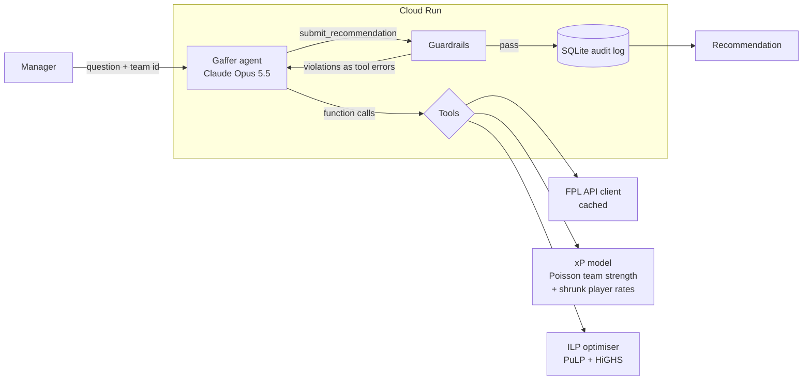

# Gaffer ⚽🤖

**An AI Fantasy Premier League manager that isn't allowed to make things up.**

Gaffer is a Claude agent that manages your FPL team. It pulls live data from the Fantasy Premier League API and projects every player's points with a probabilistic model built from scratch. It searches transfers with an integer-programming solver. Before any recommendation reaches you, deterministic guardrails check it against the FPL rules and against the model's own numbers.

An illustrative run:

```
$ gaffer advise --team 1234567 "Is it time to sell Palmer?"

  🔧 get_team_overview()
  🔧 get_player(player_id=154)
  🔧 fixture_outlook(rank_by=attack)
  🔧 optimise_transfers(max_transfers=1)
  🛡  guardrails REJECTED
     XP_TOTAL_MISMATCH: Claimed GW7 total 61.4 but the model gives 57.12 ...
  🛡  guardrails PASSED
  OUT Palmer  →  IN Mbeumo (£7.9m)
```

LLMs are good at reasoning about trade-offs ("is a −4 hit worth it for a double gameweek?") and bad at arithmetic, rules, and remembering this week's injuries. So Gaffer splits the work:

| Job | Who does it |
|---|---|
| Live player, fixture, and injury data | FPL API (tool) |
| How many points will each player score? | Poisson / Bayesian xP model (tool) |
| Best legal squad under a £100m budget | Mixed-integer program, solved by HiGHS (tool) |
| Weighing risk, explaining the plan, judgement calls | Claude |
| Is the plan legal, and are its numbers true? | Deterministic guardrails |
| Audit trail of every run, tool call, and verdict | SQLite |

## Architecture



The agent loop ([`agent.py`](src/gaffer/agent.py)) is written by hand instead of using an SDK tool runner, because the guardrails are part of the control flow:

1. Claude explores with read-only tools (`get_team_overview`, `search_players`, `get_player`, `fixture_outlook`, `optimise_transfers`).
2. It must finish by calling `submit_recommendation` (a strict JSON schema). A prose answer alone can't end a run.
3. [`guardrails.py`](src/gaffer/guardrails.py) validates the submission. Any violation goes back to Claude as a tool error with a machine-readable code, and Claude fixes it and resubmits (at most 4 attempts).
4. Every request, tool call (with latency), and guardrail verdict is written to SQLite ([`store.py`](src/gaffer/store.py)). `gaffer stats` aggregates pass rates and the most common violations.

## The guardrails

| Code | Catches |
|---|---|
| `UNKNOWN_PLAYER` | Hallucinated player ids |
| `SQUAD_SHAPE`, `CLUB_LIMIT`, `FORMATION`, `BENCH_ORDER` | Illegal squads and line-ups (2/5/5/3, max 3 per club, valid XI, reserve keeper first on the bench) |
| `OVER_BUDGET` | Plans that cost more than bank + sell value |
| `TRANSFER_OUT_NOT_OWNED`, `POSITION_SWAP`, `LINEUP_MISMATCH` | Transfers that don't line up with the actual squad |
| `HIT_MISCOUNT` | Quoting the wrong points hit for the number of transfers |
| `XP_TOTAL_MISMATCH`, `CLAIM_MISMATCH` | **Invented numbers**: every xP or price quoted in the advice must match the model within tolerance |
| `UNAVAILABLE_STARTER` | Starting an injured or suspended player (doubts are only warnings) |
| `CHIP_UNAVAILABLE` | Playing a chip already used in this half of the season |
| `CAPTAIN_NOT_IN_XI`, `CAPTAIN_EQUALS_VICE` | Captaincy mistakes |

The grounding checks matter most. Claude has to list every number it cites in `key_claims`, and each one is checked against the model. If it can't back a claim with the tools, it can't make it.

## The model

All of it lives in [`strength.py`](src/gaffer/strength.py) and [`xp.py`](src/gaffer/xp.py).

**Team strength.** A Maher / Dixon–Coles style Poisson model fitted by penalised maximum likelihood on this season's results:

$$\text{goals}_{home} \sim \text{Poisson}\big(e^{\mu + h + \alpha_{home} - \delta_{away}}\big), \qquad \text{goals}_{away} \sim \text{Poisson}\big(e^{\mu + \alpha_{away} - \delta_{home}}\big)$$

An L2 penalty on attack α and defence δ pulls every team toward league average. Early in the season one 5–0 shouldn't make a team elite. The analytic gradient goes to L-BFGS, so a fit takes milliseconds. (The FPL API's own team-strength fields are all zero this season, so the model has to estimate them.)

**Player expected points.** Each FPL scoring event is modelled as a probability, not a heuristic:

- **Minutes:** start rate and minutes per team game, multiplied by the availability flag from injury news.
- **Goals and assists:** xG/90 and xA/90, **Bayesian-shrunk** toward the positional mean (a prior worth 270 minutes, so a 90-minute cameo can't produce a superstar). They're then scaled by λ_for for this fixture ÷ the team's average λ_for in matches already played. A player's per-90 rates were earned against specific opponents, and this ratio adjusts for that.
- **Clean sheets:** P(60+ minutes) · e^(−λ_against).
- **Goals conceded:** E[⌊G/2⌋] under Poisson, computed exactly from the survival function. The same function handles save points (E[⌊S/3⌋]).
- **Defensive contribution:** P(Poisson(DC/90 · minutes) ≥ 10 or 12), following the 2025/26 rule.
- **Points per event:** read from the API's live `game_config.scoring`, so a rule change needs no code change.
- **Blank and double gameweeks:** handled naturally, because projections are per fixture and then summed.

**Optimiser.** [`optimizer.py`](src/gaffer/optimizer.py) uses binary variables for squad, XI, and captain. It maximises horizon xP for starters, plus a small weight on the bench and the captain's next-gameweek xP, minus 4 × hits. Constraints cover budget (sell prices), 2/5/5/3, 3 per club, and formation. It solves the full 667-player problem in about 0.1 seconds.

## Does the model work? A walk-forward backtest

`gaffer backtest` refits *everything* for each past gameweek *t* using only data from before *t*, predicts *t*, and scores it against what actually happened. The baselines are the stats managers usually use: **form** (points per game over the last 4 gameweeks) and **ppg** (season points per game). Each predictor also feeds the same optimiser, and the resulting XI is scored on its actual points, which measures decision quality and not just error.

2026/27 season, gameweeks 3–5 (all fully played gameweeks with at least 2 weeks of history), 364–406 players per week:

| Predictor | MAE ↓ | Spearman ρ ↑ | Top-20 picks' actual pts ↑ | Optimised XI actual pts ↑ |
|---|---|---|---|---|
| **Gaffer xP model** | **1.79** | **0.470** | **4.73** | **58.3** |
| Form (last 4 GWs) | 2.08 | 0.434 | 4.20 | 43.3 |
| Season PPG | 2.08 | 0.434 | 4.20 | 43.3 |

Compared with form, that's **14% lower MAE**. The model's XI scored **about 35% more real points** on average. Form and PPG tie because only 2–4 gameweeks have been played, so both cover the whole season so far.

> ⚠️ **Honest caveat:** three gameweeks is a small sample. The model had lower MAE every week, but in GW5 form beat it on rank correlation, top-20 picks, and XI points (57 vs 40). The backtest also leaves out injury news, which wasn't recorded historically, so it understates the live model. Rerun `gaffer backtest` as the season goes on for a firmer number; per-gameweek results land in [`reports/`](reports/).

## Quickstart

Requires Python 3.11+ and [uv](https://docs.astral.sh/uv/).

```bash
git clone <this repo> && cd gaffer
uv sync
export ANTHROPIC_API_KEY=sk-ant-...

# No API key needed for these:
uv run gaffer top --pos MID -n 10        # best projected midfielders
uv run gaffer ratings                    # team attack/defence ratings
uv run gaffer optimise --team 1234567    # pure-maths transfer plan
uv run gaffer backtest                   # walk-forward evaluation

# The agent:
uv run gaffer advise --team 1234567                    # your team (id is in the URL of your Points page)
uv run gaffer advise "Build me a wildcard squad"       # no team: drafts from scratch with £100m
uv run gaffer advise --team 1234567 --ft 2 "Should I take a hit for Haaland?"
uv run gaffer stats                                    # guardrail pass rates and violations caught
```

Configuration: `GAFFER_MODEL` (default `claude-opus-5-5`), `GAFFER_EFFORT` (default `medium`), `GAFFER_DB` (SQLite path).

## HTTP API and deployment (Google Cloud Run)

```bash
uv run gaffer serve   # http://localhost:8080/docs
```

| Endpoint | |
|---|---|
| `POST /advise` | `{"team_id": 1234567, "question": "..."}` → recommendation, guardrail report, token usage |
| `GET /players/top?position=FWD` | Model projections |
| `GET /runs/{id}` | Full audit trail of a run: tool calls, latencies, every guardrail attempt |
| `GET /stats` | Aggregate guardrail metrics |

[`deploy/cloudrun.sh`](deploy/cloudrun.sh) builds the [`Dockerfile`](Dockerfile) with Cloud Build and deploys it with the API key mounted from Secret Manager. The service requires authentication, since every call spends API credits. Setup steps are in the script header.

## Engineering notes

- **Tests (25, offline, about 2 seconds):** they run on a synthetic 20-club league. Coverage includes recovering known team strengths from simulated seasons, checking the closed-form Poisson expectations against Monte Carlo, blank and double gameweek handling, optimiser legality, every guardrail code, and the agent loop against a **scripted fake Claude** that submits a hallucinated total, gets bounced, and corrects itself. The fake checks the request is append-only, which keeps prompt caching and thinking-block replay valid.
- **CI:** ruff lint and format, plus pytest, on every push ([`.github/workflows/ci.yml`](.github/workflows/ci.yml)).
- **Cost control:** prompt caching on the static system prompt and tools, adaptive thinking with configurable effort, and token usage logged per run.
- **Resilience:** FPL responses are cached on disk with TTLs. Tool exceptions go back to the model as `is_error` results instead of crashing the run. On a safety decline, the server-side model fallback takes over.

## Known limitations

- The public API doesn't expose purchase prices, so sell prices are approximated by current prices. Free transfers are estimated from transfer history and can be overridden with `--ft`.
- Minutes modelling is the weakest part of the model: it doesn't know about rotation risk or new signings.
- The optimiser treats the horizon as one block (no week-by-week transfer planning) and ignores price changes.
- On Cloud Run the SQLite file lives on ephemeral disk. For durable history, mount a volume or point `GAFFER_DB` at persistent storage.

## Acknowledgements

Developed with the help of Claude (Anthropic) as an AI pair programmer. Data comes from the public Fantasy Premier League API. This project isn't affiliated with the Premier League.
